<a href="https://gallowforge.github.io/seaward/#gh-dark-mode-only"><picture><source media="(max-width: 767px)" srcset="docs/readme/hero-dark-phone.webp 2.835x"><source srcset="docs/readme/hero-dark.webp 2x">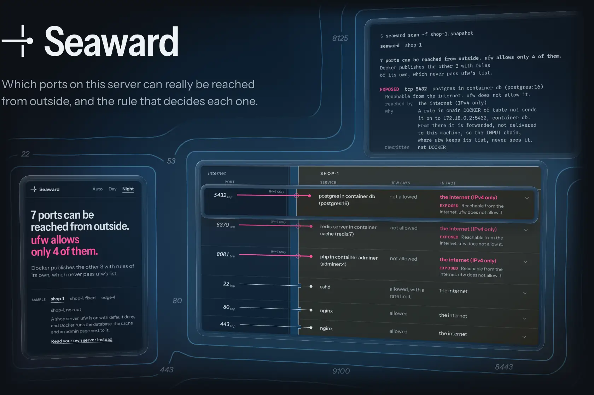</picture></a><a href="https://gallowforge.github.io/seaward/#gh-light-mode-only"><picture><source media="(max-width: 767px)" srcset="docs/readme/hero-light-phone.webp 2.835x"><source srcset="docs/readme/hero-light.webp 2x">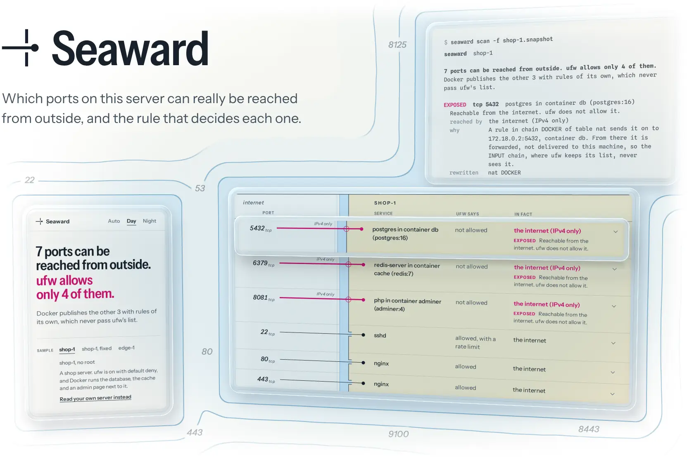</picture></a>

A firewall manager shows you a list: these ports are allowed, the rest are denied. The kernel never reads that list. It reads the rules that are loaded, and other programs load rules of their own. Docker is the best-known case: a container started with `-p 5432:5432` answers the whole internet on a server where ufw denies everything but ssh, because Docker's rules rewrite the packet's destination to the container. From there it is forwarded, and the INPUT chain, where ufw keeps its list, never sees it. **Seaward reads the rules that are really loaded, follows a packet through them the way the kernel does, and says for every port who can reach it and which rule decides that.** It only reads. It changes no rule and puts no packet on the network: the packets it follows are worked out from the rules, not sent.

<p align="center"><a href="https://gallowforge.github.io/seaward/"><b>Live demo</b></a> &nbsp;·&nbsp; <a href="#quickstart"><b>Quickstart</b></a> &nbsp;·&nbsp; <a href="#how-it-works">How it works</a> &nbsp;·&nbsp; <a href="#what-it-does-not-see">Limits</a> &nbsp;·&nbsp; <a href="DESIGN.md">Design notes</a> &nbsp;·&nbsp; <a href="SECURITY.md">Security</a> &nbsp;·&nbsp; <a href="CHANGELOG.md">Changelog</a></p>

<a href=".github/workflows/ci.yml#gh-dark-mode-only"><picture><source media="(max-width: 767px)" srcset="docs/readme/numbers-dark-phone.webp 2.835x"><source srcset="docs/readme/numbers-dark.webp 2x">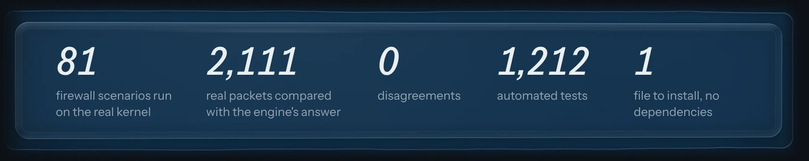</picture></a><a href=".github/workflows/ci.yml#gh-light-mode-only"><picture><source media="(max-width: 767px)" srcset="docs/readme/numbers-light-phone.webp 2.835x"><source srcset="docs/readme/numbers-light.webp 2x">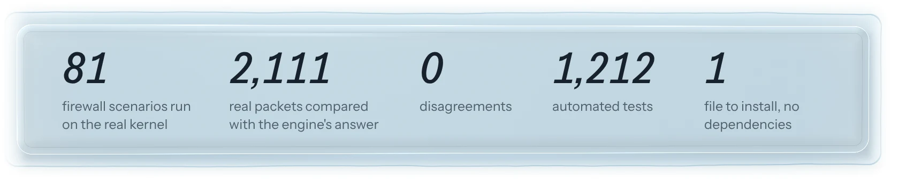</picture></a>

<sub>The scenarios are rulesets loaded into the real kernel, each in a network namespace of its own; the packets are real connections and datagrams sent through them, and the engine has to call every one. The tests are the Go test cases plus the demo page's own. The file is the static binary on the releases page. Every picture here stages the real output of the binary, or the real demo page, as panes of glass.</sub>

## The firewall says closed. The kernel says open.

`seaward scan` puts first the ports that can be reached although your firewall manager never allowed them. On the sample server below, seven ports can be reached and ufw allows only four of them: Docker publishes the database, the cache and an admin page, and each one is shown with the rule that rewrites the packet and the rule that lets it through. After those comes one line a port: who can reach it (the internet, the local network, VPN peers, one address range, nobody) and what the firewall manager says about it.

<a href="https://gallowforge.github.io/seaward/#gh-dark-mode-only"><picture><source media="(max-width: 767px)" srcset="docs/readme/exposed-dark-phone.webp 2.835x"><source srcset="docs/readme/exposed-dark.webp 2x">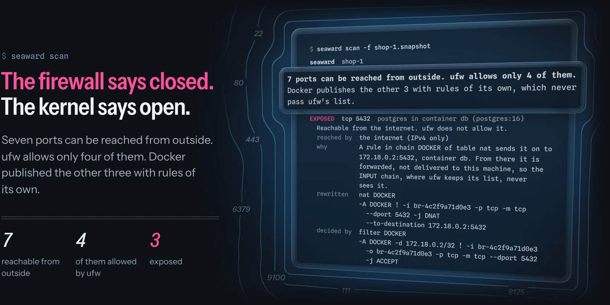</picture></a><a href="https://gallowforge.github.io/seaward/#gh-light-mode-only"><picture><source media="(max-width: 767px)" srcset="docs/readme/exposed-light-phone.webp 2.835x"><source srcset="docs/readme/exposed-light.webp 2x">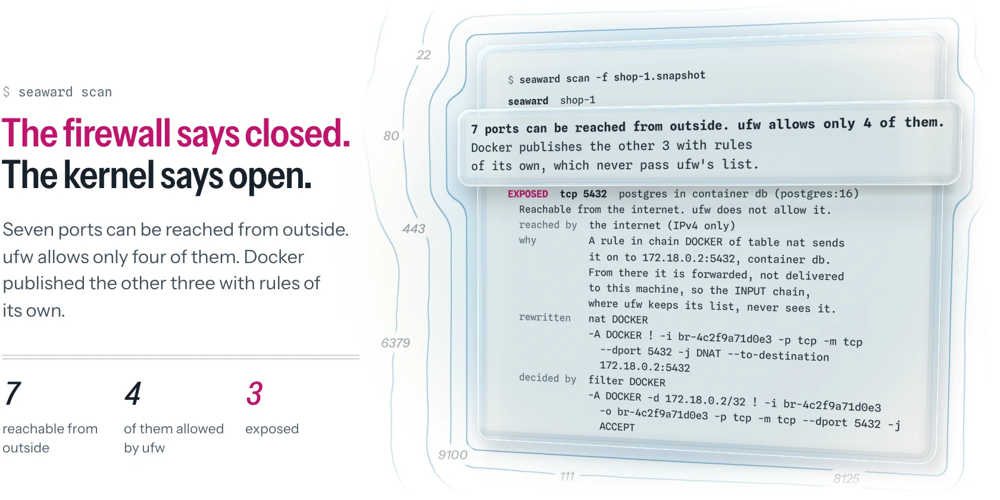</picture></a>

## Every answer names its rule

`seaward why 5432` follows one packet from the interface it arrives on to the program that answers: every chain it enters, the rule that matched there, where its destination was rewritten, how it was routed and the rule or policy that settled it, in the kernel's own order. Each rule is printed as it is loaded, so you can find it and change it. Add `--from 198.51.100.20` to follow a packet from one sender.

<a href="DESIGN.md#gh-dark-mode-only"><picture><source media="(max-width: 767px)" srcset="docs/readme/why-dark-phone.webp 2.835x"><source srcset="docs/readme/why-dark.webp 2x">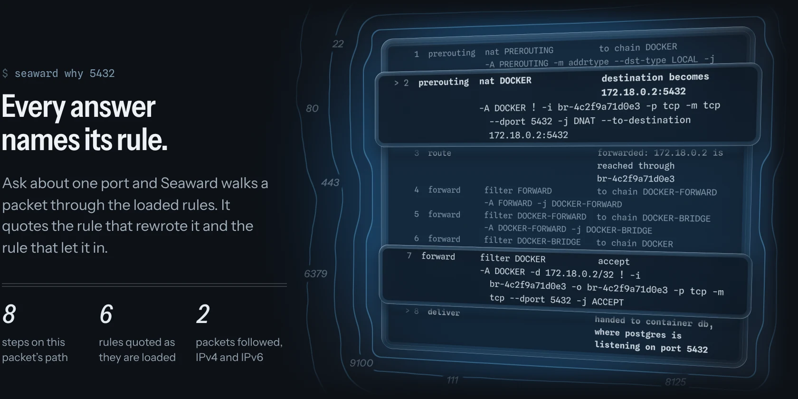</picture></a><a href="DESIGN.md#gh-light-mode-only"><picture><source media="(max-width: 767px)" srcset="docs/readme/why-light-phone.webp 2.835x"><source srcset="docs/readme/why-light.webp 2x">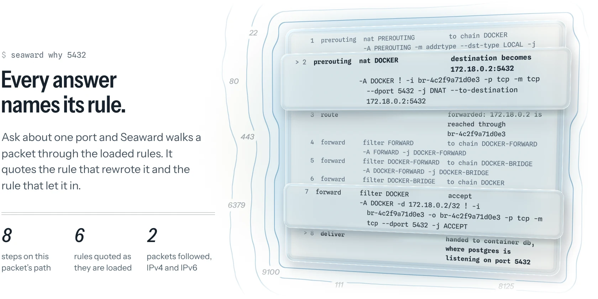</picture></a>

## Checked against the real kernel

A model of a firewall is worth what the kernel says about it. Seaward's lab loads 80 written rulesets and 40 random ones into the real kernel, each inside a network namespace that is gone afterwards, sends 2,105 real packets through them and compares what happened with what the engine said. One difference fails the build. The scan is held to the same packets: a port the kernel answers on has to be a port the scan found by itself and calls reachable. Then CI does the same on whole machines, one with ufw and one with firewalld, where Docker publishes a port neither allows: real connections from outside have to do what Seaward said they would.

<a href="internal/lab/scenarios#gh-dark-mode-only"><picture><source media="(max-width: 767px)" srcset="docs/readme/kernel-dark-phone.webp 2.835x"><source srcset="docs/readme/kernel-dark.webp 2x">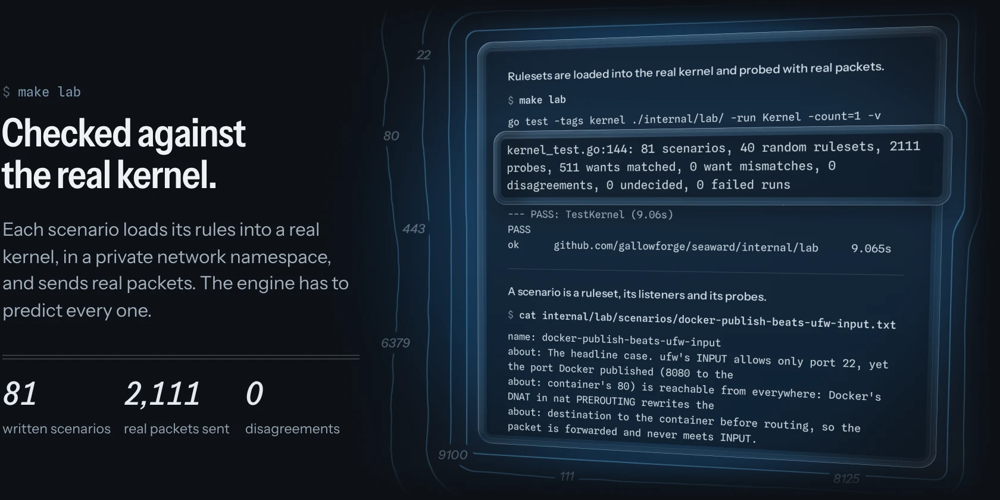</picture></a><a href="internal/lab/scenarios#gh-light-mode-only"><picture><source media="(max-width: 767px)" srcset="docs/readme/kernel-light-phone.webp 2.835x"><source srcset="docs/readme/kernel-light.webp 2x">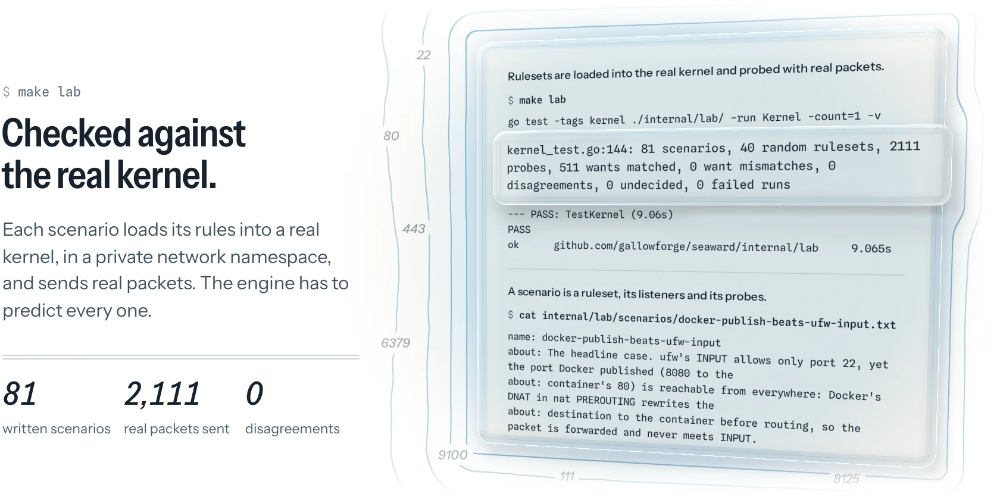</picture></a>

## When it cannot know, it says so

Some rules look inside the packet, and some hang on a set that could not be read. Seaward does not guess at those. It follows both answers: when they end the same way the result stands, and when they do not the port is reported as undecided, with the rule it hangs on. Run without root, it says the rules could not be read and decides nothing. It does not show you an empty firewall.

<a href="https://gallowforge.github.io/seaward/#gh-dark-mode-only"><picture><source media="(max-width: 767px)" srcset="docs/readme/unknown-dark-phone.webp 2.835x"><source srcset="docs/readme/unknown-dark.webp 2x">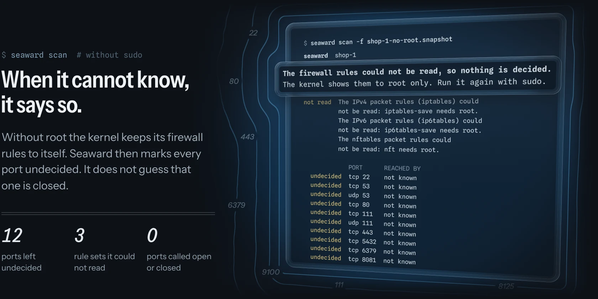</picture></a><a href="https://gallowforge.github.io/seaward/#gh-light-mode-only"><picture><source media="(max-width: 767px)" srcset="docs/readme/unknown-light-phone.webp 2.835x"><source srcset="docs/readme/unknown-light.webp 2x">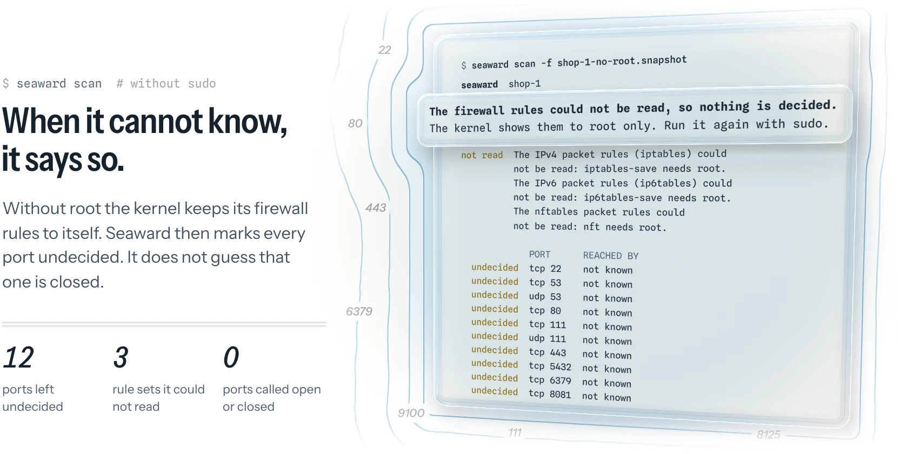</picture></a>

## Read a server from your laptop

`seaward snapshot` saves what a scan reads as one text file: the rules, the listeners, the addresses and routes, Docker's published ports. Read it anywhere with `seaward scan -f`, on Linux or macOS, or drop it on the [demo page](https://gallowforge.github.io/seaward/), where the same engine runs in your browser and the file never leaves it. For a server you would rather not put a binary on, `seaward snapshot --script` prints the collector as a plain shell script, about 135 lines, to read before you run it.

<a href="SECURITY.md#gh-dark-mode-only"><picture><source media="(max-width: 767px)" srcset="docs/readme/snapshot-dark-phone.webp 2.835x"><source srcset="docs/readme/snapshot-dark.webp 2x">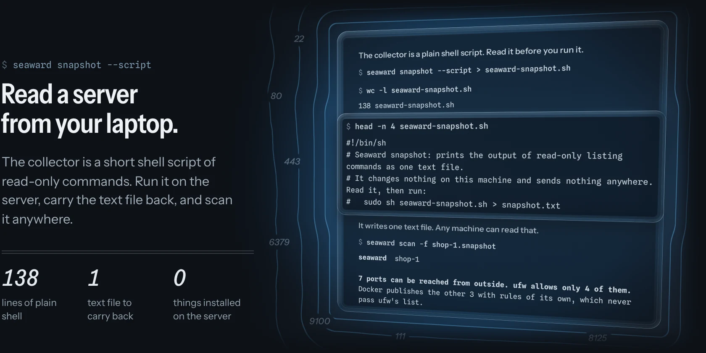</picture></a><a href="SECURITY.md#gh-light-mode-only"><picture><source media="(max-width: 767px)" srcset="docs/readme/snapshot-light-phone.webp 2.835x"><source srcset="docs/readme/snapshot-light.webp 2x">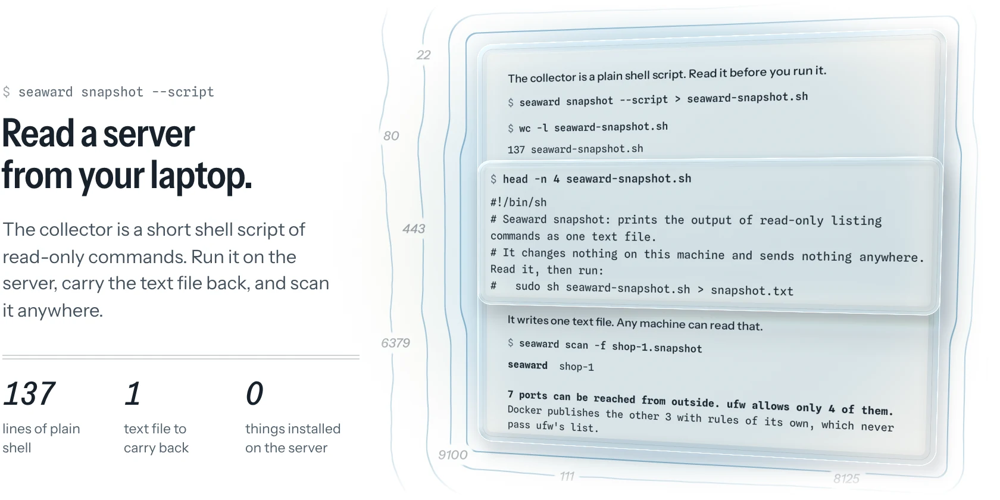</picture></a>

## Why it is different

| | The firewall manager's list | A port scan from outside | Seaward |
| --- | --- | --- | --- |
| What it reads | What the manager was told to allow | What answered, from one place at one moment | The rules loaded in the kernel, the listeners and Docker's published ports |
| A port Docker publishes | Not in the list | Open, with no reason given | Exposed, with the rule that lets it through |
| Who can reach a port | Not said | Only the place you scanned from | The internet, the local network, VPN peers or one address range, each named |
| Why | Not said | Not said | The packet's path, rule by rule |
| A firewall in front of the machine | Not seen | Seen | Not seen, and every scan report says so |
| What it does to the server | Nothing | Sends packets | Nothing: it reads |

A port scan and Seaward answer different questions and go well together. The scan shows what one outside address sees, through everything in between. Seaward shows what this machine would let in from anywhere, and the rule to change when that is too much.

## Quickstart

The quickest look is the [live demo](https://gallowforge.github.io/seaward/): the real engine in a browser tab, on four sample machines or a snapshot of your own.

To run it on a server, take the binary for your system from the [releases page](https://github.com/gallowforge/seaward/releases/latest) (Linux or macOS, amd64 or arm64):

```bash
curl -fsSLo seaward https://github.com/gallowforge/seaward/releases/latest/download/seaward-linux-amd64
chmod +x seaward && sudo mv seaward /usr/local/bin/
sudo seaward scan            # every port, who can reach it, and the rule that decides
sudo seaward why 5432        # one packet to one port, rule by rule
```

The kernel shows its packet rules to root only, which is why a scan wants `sudo`.

### No server at hand

The sample machines are snapshots in this repository, and reading a snapshot needs no root:

```bash
curl -fsSLO https://raw.githubusercontent.com/gallowforge/seaward/main/samples/shop-1.snapshot
seaward scan -f shop-1.snapshot
seaward why 5432 -f shop-1.snapshot
seaward why 9100 --from 198.51.100.20 -f shop-1.snapshot
```

```text
seaward  shop-1

7 ports can be reached from outside. ufw allows only 4 of them.
Docker publishes the other 3 with rules of its own, which never pass ufw's list.

EXPOSED  tcp 5432  postgres in container db (postgres:16)
  Reachable from the internet. ufw does not allow it.
  ...
```

### A server you read from somewhere else

```bash
sudo seaward snapshot -o server.snapshot      # on the server
seaward scan -f server.snapshot               # anywhere, Linux or macOS
```

Or in one line, with nothing left on either disk:

```bash
ssh server sudo seaward snapshot | seaward scan -f -
```

Without the binary on the server:

```bash
seaward snapshot --script > seaward-snapshot.sh     # read it, then copy it over
sudo sh seaward-snapshot.sh > server.snapshot       # on the server
```

A snapshot holds rules, addresses, listening ports, and the name, image and published ports of each container. It holds no container environment, command line, label or mount, and no keys. Hardware (MAC) addresses are masked; [SECURITY.md](SECURITY.md) says what in a snapshot still points at one machine. Under `sudo`, `snapshot -o` gives up root before it writes, so the file is yours and readable by you alone. [SECURITY.md](SECURITY.md) lists every command a scan runs.

### In cron or CI

```bash
seaward scan --check
```

`--check` exits with status 3 when a port is exposed, 4 when none is exposed but a port is undecided, some rules could not be read or the scan stopped at a ceiling before it had asked everything, and 0 otherwise. Exposed means reachable although the firewall manager does not allow it, so on a machine with no firewall manager there is no list to compare with and the status is 0. `--json` prints the whole report, with every step of every packet, and `seaward why 5432 --json` does the same for one port.

### Build from source

```bash
git clone https://github.com/gallowforge/seaward && cd seaward
make            # bin/seaward; needs Go 1.24 or newer, nothing else
make test       # the Go tests with the race detector, then the page's
make lab        # the engine against the real kernel, in private network namespaces
```

`make lab` needs no root where unprivileged user namespaces are allowed; CI, where they are not, makes the namespaces with `sudo`. It cannot touch the machine's own rules: every ruleset is built inside a new network namespace that starts with nothing but a loopback interface, and the launcher refuses to run anywhere else.

## How it works

1. **It collects.** A fixed list of listing commands, each with a five second limit: the packet rules (`iptables-save`, `nft list ruleset`, `ipset save`), what is listening (`ss`), interfaces and routes (`ip`), the forwarding sysctls, Docker's containers and published ports, and what ufw or firewalld say they allow. That is the whole snapshot.
2. **It reads both listings of the rules.** On a current system iptables and nft write into the same kernel tables, and neither listing is complete alone. iptables-save has no words for some of what nft can write and, as of version 1.8.13, prints it wrongly without a warning: the rule `tcp dport { 25, 587 } accept` comes out as `-A INPUT -p tcp -j ACCEPT`, and a lookup in a named set as a bare `-A INPUT -j ACCEPT`. Seaward settles the two listings rule by rule and takes each rule from the one that can say it.
3. **It walks a packet.** The first packet of a new connection goes through the hooks in the kernel's order: the ingress chains of the interface it arrives on; prerouting, where a rule may rewrite its destination; routing, which decides between this machine and somewhere else; then input and the listening sockets, or forward and the container behind it. Tables, priorities, jumps, returns, sets, verdict maps, marks and connection state behave as they do in the kernel.
4. **It asks from everywhere.** Each outside interface is a place a packet can come from: the internet, the local network, VPN peers. From each, packets go to every address the machine holds, including a spare one on the loopback or a bridge's, because Linux answers for all of them. The rules tell senders apart by address, so Seaward collects every such condition, cuts the address space wherever one of them starts or ends, and follows one packet for each group the rules single out, plus one for everybody else. Two senders no rule tells apart are treated alike by every rule, so this covers every sender the rules can tell apart and is not a sample, up to the ceiling of 1,024 groups, and it says so when the ceiling is reached. The ports asked about are everything that listens, everything Docker publishes, everything the firewall manager names and every TCP or UDP port whose packets can come as far as a rule that sends them somewhere else, whether that rule names the port itself or stands in a chain that the rule naming it jumps to. A range of more than 16 ports is asked at its ends and wherever a rule, a listener or the target of a rewrite sets a port apart, and a count that includes such a port reads "at least". The ceiling for ports is 4,096. A report that reaches a ceiling lists what was not asked at the top and claims nothing about it: "nothing was found reachable", "at least 3 ports", "nobody that was asked".
5. **It gives each port one finding**, with the reason in a sentence and the deciding rule:

| Finding | Meaning |
| --- | --- |
| `exposed` | Reachable from outside although the firewall manager does not allow it |
| `open` | Reachable from outside as the firewall manager allows, or by anyone when there is no manager |
| `limited` | No firewall manager, and the rules let only some senders in: one network, a set, VPN peers |
| `undecided` | Hangs on something Seaward cannot see, or the scan stopped before it had asked every sender; the reason is given |
| `local` | Reachable from this machine only |
| `blocked` | Something listens and the rules stop every packet |
| `shadowed` | The firewall manager allows it, yet an earlier rule stops it |
| `dead` | Allowed or published, and nothing answers |
| `closed` | Nothing listens and nothing is let through |

[DESIGN.md](DESIGN.md) has the model, the walk and what the kernel taught along the way.

### What it does not see

- **Anything in front of the machine.** A cloud firewall, a security group, a router. Seaward says what this machine lets in, and every scan report says so.
- **Parts of the kernel it does not model:** eBPF programs (XDP, tc, cgroup), IPVS, IPsec, policy routing beyond the main table, reverse-path filtering and the kernel's refusal of impossible source addresses. Replies are assumed to get out.
- **Chains it does not follow.** nftables chains on an egress hook or in a bridge table are not walked rule by rule. A port whose packets pass one is reported as undecided, and the chain is named.
- **Protocols other than TCP and UDP, in a scan.** A scan has rows for TCP and UDP ports. `seaward why 5000/sctp --from 198.51.100.7` follows one packet of SCTP, DCCP or UDP-Lite.
- **Rate limits beyond the first packet.** A rule that lets the first connection through and slows the tenth counts as letting it through.
- **Rules on the sender's port.** The packets Seaward follows leave from an ordinary high port, so a rule that lets in one source port only is not flagged.
- **Link-local, multicast and broadcast traffic.** The scan follows no packet to those addresses, so firewalld's DHCPv6 opening appears in its list and nowhere else, and DHCP is not judged.
- **firewalld's rich rules, forward ports and source ports** are not read into the "firewalld says" column, and the report notes it. The verdict on each port does not depend on that column: it comes from the loaded rules.
- **Docker's nftables backend,** which Docker still marks experimental, has not been tested.

A rule Seaward has no model for is never skipped silently. It makes the port undecided and is named.

## Quality

- **1,194 automated tests** run on every change: 1,116 Go test cases with the race detector, and 78 for the demo page.
- **The kernel is the judge.** 80 scenarios and 40 random rulesets, 2,105 real packets, 0 disagreements. A scenario also states what a person expects, so a wrong belief about the kernel fails the build as well as a wrong engine.
- **Two whole machines.** CI turns on ufw on one runner and firewalld on another, publishes a container past each, and compares Seaward's answer for three ports with real connections from outside.
- **No condition is dropped.** A test goes through every option of every rule in the fixtures and fails unless each is either modelled or surfaces as unknown.
- **Seven fuzz targets** cover the parsers for rules, sets, sockets, ufw and the snapshot format.
- **No dependencies** outside the Go standard library. One static binary, the same engine compiled to WebAssembly for the demo.
- **Read-only by construction.** The collector's commands are a fixed list in one file. [SECURITY.md](SECURITY.md) names each one.

## FAQ

**Does it change anything on my server?**
No. It runs listing commands and reads their output. It adds no rule, opens no port and puts no packet on the network.

**Is it a port scanner?**
No. A scanner sends packets and reports what answered. Seaward sends nothing: it reads the rules and works out what would answer, from anywhere, and why. It cannot see a firewall in front of the machine, which a scan from outside can.

**Does it fix the Docker and ufw problem?**
It shows it, with the rule. The fix is yours to choose. Publish the port on this machine only (`-p 127.0.0.1:5432:5432`) and put a proxy in front. Or add your own rules to the `DOCKER-USER` chain, which Docker leaves alone; a rule there sees the packet after its destination was rewritten, so match the port it first arrived on with conntrack (`-m conntrack --ctorigdstport 5432`), not with `--dport`. The sample "shop-1, fixed" is the same server after the first of those, with an unused rpcbind and a rule for a port nothing listens on cleared away as well: four ports can be reached, ufw allows all four, and the three container ports answer this machine only.

**Why does it need root?**
The kernel shows its packet rules to root only. Without root Seaward lists what is listening, says the rules could not be read and decides nothing.

**Which systems does it read?**
Linux with iptables (the nf_tables or the legacy backend), nftables or both, with or without ufw, firewalld and Docker. A snapshot can be read on Linux and macOS, and in a browser.

## Contributing

Issues and pull requests are welcome. A new case is best sent as a scenario file in `internal/lab/scenarios/`, where the kernel settles it.

## Licence

[MIT](LICENSE)
